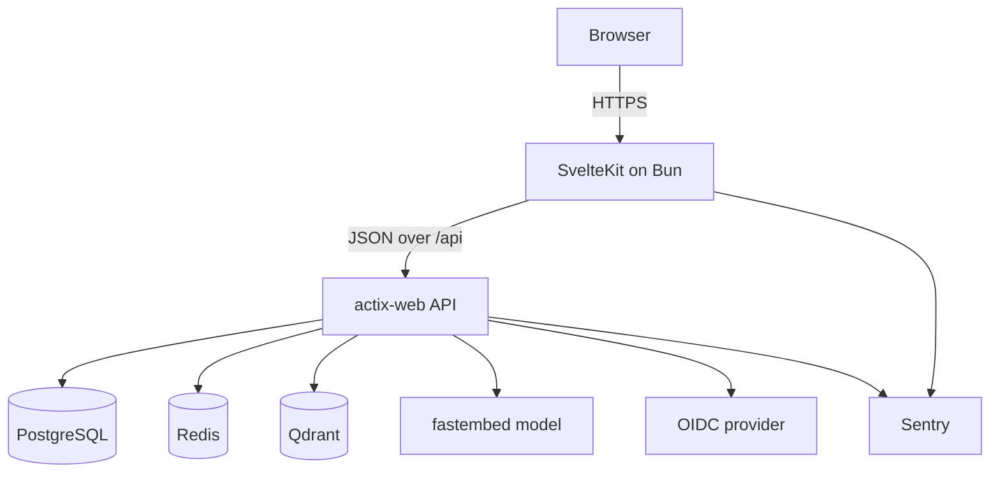

# Project Structure & Architecture

How this repository is organised, why it is organised that way, and the coding
conventions that keep it consistent. Read this before adding a feature; read the
sub-project READMEs for day-to-day setup commands.

Both the backend and the frontend implement the same Clean Architecture layering, so
the mental model transfers between them. Section 3 explains the shared shape, then
sections 4 and 5 apply it to each stack.

## 1. System at a glance

Two independently built and deployed services:

- **Frontend** — SvelteKit 5 (Svelte runes), Tailwind CSS 4, built and served on Bun.
  It owns everything the public sees, including the URL scheme (`/post/<semantic id>`),
  `/sitemap.xml`, and `/feed.xml`.
- **Backend** — a Rust `actix-web` JSON API that owns persistence, authentication, and
  semantic search. It knows nothing about pages or URLs beyond its own routes.

Supporting services: PostgreSQL (source of truth), Redis (sessions and query-embedding
cache), Qdrant plus a local embedding model (`fastembed`) for semantic search, and an
external OIDC provider for login. Both services report to Sentry.

The split is deliberate: SvelteKit is full-stack, but the API is kept separate to keep
coupling low and to practise building a pure backend. In development Vite proxies
`/api/*` to `http://127.0.0.1:8080/*` and strips the prefix ([`frontend/vite.config.ts`](../frontend/vite.config.ts)),
so the frontend always talks to a relative `PUBLIC_API_BASE_URL`.

## 2. Repository layout

| Path | What lives there |
| --- | --- |
| `backend/` | Rust workspace: `server`, `shared`, and one crate per feature under `feature/` |
| `frontend/` | SvelteKit app: `src/routes/` for pages, `src/lib/` for feature modules |
| `manifest/` | Kubernetes manifests used for self-hosting |
| `script/` | `pre-commit` hook scripts (backend check, sqlx prepare, frontend lint) |
| `docs/` | This document and [git-convention.md](./git-convention.md) |
| `.gitea/` | CI workflows and the pull request template |
| `.agents/skills/` | Agent instructions, notably the strings/links and git rules |

## 3. Clean Architecture, applied twice

Every feature is a vertical slice with four layers. Dependencies only point inward:
`framework` → `adapter` → `application` → `domain`.

| Layer | Backend (Rust) | Frontend (TypeScript) | Knows about |
| --- | --- | --- | --- |
| `domain` | Entities and a feature error enum | Entities | Nothing outside itself |
| `application` | Use case traits + `port/` traits the feature needs | Use case classes + `port/` interfaces | `domain` |
| `adapter` | `port/` (infrastructure traits), `gateway/` (implementations + `dto/`), `delivery/` (controllers + DTOs) | `port/` (API client interfaces), `gateway/` (repository + `dto/`), `presenter/` (`store/`, `viewModel/`) | `application`, `domain` |
| `framework` | `db/`, `web/`, `storage/`, `cache/`, `oidc/` — actix-web, sqlx, Qdrant, Redis | `api/`, `ui/` — Svelte components, `fetch`, Sentry | Everything; nothing imports it except the composition root |

Two consequences worth internalising:

1. **No framework types leak inward.** `domain` and `application` never import
   `actix_web`, `sqlx`, or `serde` (backend), and entities never import Svelte or
   `fetch` (frontend).
2. **Cross-feature calls go through the other feature's application port.** For example
   the post feature reads images through `image::application::port::ImageRepository`
   rather than reaching into `image`'s database layer, and the image feature asks
   whether an image is still referenced through the
   `ImageReferenceChecker` trait that `PostRepositoryImpl` implements.

## 4. Backend

### 4.1 Crates

| Crate | Role |
| --- | --- |
| `server` | `main.rs` bootstrap, per-concern configuration, and the composition root |
| `shared` | Error wrappers (`IOError`, `DatabaseError`) shared across features |
| `feature/auth` | OIDC login, Redis-backed sessions, `UserId` extractor and middleware |
| `feature/post` | Posts, semantic ids, labels and images attached to a post |
| `feature/label` | Labels and their colours |
| `feature/image` | Upload, metadata, storage, reference counting |
| `feature/search` | Embedding, Markdown splitting, Qdrant indexing, Redis query cache |

Each feature crate exposes exactly four modules from its `lib.rs`:
`adapter`, `application`, `domain`, `framework`.

### 4.2 Naming

The names encode the layer, so a file's path in the tree is predictable from its name:

| Suffix / pattern | Layer | Example |
| --- | --- | --- |
| `XxxRepository`, `XxxService` (trait) | `application/port` | `application/port/post_repository.rs` |
| `XxxRepositoryImpl` | `adapter/gateway` | `adapter/gateway/post_repository_impl.rs` |
| `XxxDbService`, `XxxStorage`, `XxxOidcService` (trait) | `adapter/port` | `adapter/port/post_db_service.rs` |
| `XxxDbServiceImpl`, `XxxStorageImpl` | `framework/db`, `framework/storage` | `framework/db/post_db_service_impl.rs` |
| `XxxUseCase` (trait) + `...UseCaseImpl` | `application/use_case` | `application/use_case/create_post_use_case.rs` |
| `XxxDbModel` | `adapter/gateway/dto` | `adapter/gateway/dto/post_db_model.rs` |
| `XxxRecord` (a row as read from the database) | `framework/db` | `framework/db/post_with_label_record.rs` |
| `XxxRequestDto`, `XxxResponseDto`, `XxxQueryDto` | `adapter/delivery` | `adapter/delivery/create_post_request_dto.rs` |
| `XxxController` (trait) + `XxxControllerImpl` | `adapter/delivery` | `adapter/delivery/post_controller.rs` |
| `xxx_handler` | `framework/web` | `framework/web/get_post_by_id_handler.rs` |
| `configure_xxx_routes` | `framework/web` | `framework/web/post_web_routes.rs` |

One trait per concern keeps the layers swappable and makes the composition root the only
place that names a concrete type.

### 4.3 A request, layer by layer

`GET /post/{id}` (works with either a numeric id or a semantic id):

1. `framework/web/post_web_routes.rs` matches the route to `get_post_by_id_handler`.
2. `framework/web/get_post_by_id_handler.rs` is the only place that knows HTTP. It
   carries the `utoipa::path` annotation, extracts `web::Data<dyn PostController>` and
   the optional `UserId`, then maps the result to a status code.
3. `adapter/delivery/post_controller.rs` decides numeric-vs-semantic, calls the right
   use case, and converts the domain entity to `PostResponseDto`.
4. `application/use_case/get_post_by_id_use_case.rs` holds the rule "an unpublished post
   is only visible to a logged-in user", then asks `PreviewImageMetadataService` to
   enrich the post with its preview image's MIME type and size.
5. `application/port/post_repository.rs` is the trait it depends on;
   `adapter/gateway/post_repository_impl.rs` implements it by delegating to
   `PostDbService` and mapping `DbModel` → entity.
6. `framework/db/post_db_service_impl.rs` runs the `sqlx` query.

### 4.4 Composition root

There is no DI framework. `server/src/container.rs` constructs every service, repository,
use case, and controller by hand, in dependency order, and hands back the four
controllers. `server/src/main.rs` then registers each controller as
`web::Data<dyn XxxController>` and calls the `configure_*_routes` functions.

Practical rule: a new dependency is wired in `container.rs`, never resolved inside a use
case or handler.

### 4.5 Errors

- Each feature has one error enum in `domain/error/`, for example `PostError`, with
  variants for the failure modes the domain actually has, plus
  `Unexpected(anyhow::Error)`.
- Errors implement `Display` and convert to `String`; they do not implement
  `IntoResponse`, because HTTP is a delivery concern.
- Handlers map each variant to a status code. Anything unhandled falls through to `500`
  **and** is reported with `capture_anyhow` — so a silent 500 is a bug.
- Cross-feature failures wrap the inner error (for example
  `PostError::LabelError(LabelError)`), preserving the cause.

### 4.6 Persistence

- SQL lives only in `framework/db`; entities and use cases never see a table.
- Migrations are `sqlx` migration files in `backend/migrations/`, named
  `<timestamp>_<description>.sql`, with a matching `.down.sql` when the change is
  reversible. Table and schema-object names are plural (`posts`, `labels`,
  `post_labels`, `images`, `post_images`, `users`).
- `backend/.sqlx/` holds the offline query cache and is committed. After changing a
  query, run `cargo sqlx prepare --workspace`; CI fails if the cache is stale.
- Timestamps go through the `update_updated_time_column` trigger created in the first
  migration.

### 4.7 HTTP surface and docs

Routes are grouped by feature with `web::scope`, for example `/post`, `/label`, `/image`,
`/auth`. Every handler carries a `utoipa::path` annotation, and
`server/src/api_doc.rs` merges each feature's `*_api_doc` module. The result is served
as Redoc at `/redoc`; authentication is documented as an OAuth2 authorisation-code flow.
When you add an endpoint, add its annotation and register it in the feature's
`configure_*_routes`, or the route and the docs drift apart.

### 4.8 Configuration

`server/src/configuration/` has one module per concern (`db`, `redis`, `qdrant`,
`embedding`, `oidc`, `session`, `storage`, `sentry`, `server`), each reading its own
environment variables. Add a new dependency by adding a module here and consuming it in
`container.rs`. See [`backend/.env.example`](../backend/.env.example) for the full list.

## 5. Frontend

### 5.1 Layers

The same four layers, with the presentation layer replacing delivery:

| Layer | Contents |
| --- | --- |
| `domain` | Entities, e.g. `post/domain/entity/post.ts` |
| `application` | `useCase/*.ts` classes and `port/` interfaces; `validation/` holds zod form schemas |
| `adapter` | `port/` (API service interfaces), `gateway/` (repository + `dto/`), `presenter/` (`store/`, `viewModel/`) |
| `framework` | `api/` (real HTTP calls), `ui/` (`.svelte` components) |

`src/lib/shared/` holds cross-feature building blocks with the same layering: the
`ApiClient`, `AsyncState`/`BaseActionStore`, and the shared UI kit.

### 5.2 Runtime wiring

- `src/hooks.server.ts` creates a `Container` per request and stores it in
  `event.locals.container`, so `+page.server.ts` loaders can use it during SSR.
- `src/routes/+layout.svelte` creates one `Container` for the browser and publishes it
  through `setContainer()`; components reach it with `getContainer()`.
- Stores that must be shared across components (the drawer, the navbar's label list) are
  placed in Svelte context keyed by `StoreClass.name`, and read with
  `getContext<Store>(Store.name)`.
- `src/lib/container.ts` aggregates per-feature factories from each `composition.ts`.
  A feature's `composition.ts` builds its API service → repository → use cases → store
  factories. This is the frontend's composition root: concrete classes are named only
  here.

### 5.3 A page load, layer by layer

1. `src/routes/post/[id]/+page.server.ts` calls `container.createPostLoadedStore()` and
   `store.trigger(params.id)`, maps "no data" to `error(404, …)`, and returns
   `state.data.dehydrate()`.
2. `PostLoadedStore` (in `adapter/presenter/store/`) extends `BaseActionStore`, which
   owns loading/success/error transitions and reports thrown errors to Sentry.
3. `GetPostUseCase` calls `PostRepository`.
4. `PostRepositoryImpl` calls `PostApiService`, and maps the returned DTO to an entity
   with `dto.toEntity()`.
5. `PostApiServiceImpl` composes an `ApiClient` call. It only chooses the endpoint and
   the DTO parser; `ApiClient` owns URL resolution, JSON parsing, and `ApiError`
   mapping.
6. `+page.svelte` rehydrates the dehydrated view model and renders it.

`dehydrate()` / `rehydrate()` on view models is how SSR data crosses to the client
without leaking class instances.

### 5.4 Routes

`src/routes/` stays thin: `+page.server.ts` for data, `+page.svelte` for markup. Rules
that follow from the codebase:

- Do not call the API from a component; go through the container's stores.
- Navigate with `resolve()` from `$app/paths` for internal routes; `Links` is for
  external URLs only.
- `+server.ts` endpoints exist for generated documents (`feed.xml`, `sitemap.xml`), not
  for wrapping the backend API.

### 5.5 Strings and links

User-facing text belongs in `src/lib/strings.ts` (`Strings`, abstract class of
`static readonly` members, roughly alphabetical) and fixed URLs belong in
`src/lib/links.ts` (`Links`, `URL` constants plus URL builders for share intents).
Components never hardcode UI text or URLs. Configuration-derived values come from
`Environment` (`src/lib/environment.ts`).

### 5.6 Styling and UI

Tailwind CSS 4 via `@tailwindcss/vite`; the shared primitive components in
`src/lib/shared/framework/components/ui/` are shadcn-svelte-style wrappers over
`bits-ui`, so their file names are lowercase and kebab-case (`dialog-content.svelte`).
Feature UI components are plain Svelte components in PascalCase
(`PostPreview.svelte`). Class names are merged with `cn()` from
`shared/framework/components/utils.ts`.

## 6. Coding conventions

### Rust

- Edition 2024; workspace version and dependencies are declared once in
  `backend/Cargo.toml` and referenced with `workspace = true`.
- Async traits use `#[async_trait]`; shared collaborators are held as
  `Arc<dyn Trait>` and every trait is `Send + Sync`.
- Files and functions `snake_case`, types `PascalCase`, error enums named after the
  feature (`PostError`, not `Error`).
- Prefer `?` plus `map`/`map_err` over explicit `match` for propagation; keep `match` for
  genuine branching.
- `cargo clippy` is run by CI; treat warnings as failures even though the step itself
  does not pass `-D warnings`. Formatting is default `rustfmt` (4 spaces), with no
  `rustfmt.toml` overrides.
- Prefer `?` over `unwrap()`. `expect()` with a message is used in bootstrap and
  configuration code to fail fast on misconfiguration, and on compile-time regexes that
  cannot fail at runtime; request paths propagate errors instead. One current exception
  is the OIDC code exchange in `auth_oidc_service_impl.rs`, which unwraps the request
  builder.

### TypeScript and Svelte

- Path aliases only: relative imports are rejected by ESLint
  (`$lib/...` for library code). Import order is enforced by `simple-import-sort`.
- Formatting is Prettier with the Svelte and Tailwind plugins, configured in
  [`frontend/.prettierrc`](../frontend/.prettierrc): tabs, single quotes, 100 columns.
  `bun run lint` checks both Prettier and ESLint.
  Note the deliberate asymmetry: the Rust side uses 4-space indentation, the TypeScript
  side uses tabs.
- Svelte 5 runes: components use `$props()`, `$state()`, `$derived()`. Stores follow the
  Svelte store contract and are read with `$derived($store)`.
- Classes and types `PascalCase` (`PostRepositoryImpl`), functions and variables
  `camelCase`, module files `camelCase` (`postRepositoryImpl.ts`).
- DTO classes own their serialisation: a `zod` schema validates the wire shape (still
  `snake_case`, taking `unknown`), the class holds `camelCase` fields with a private
  constructor, and exposes `fromJson`, `toJson`, `toEntity` (and `fromParams` for
  requests). Entities stay plain; view models own presentation formatting and
  `dehydrate()`/`rehydrate()`.

### Data and naming across the boundary

The two sides speak the same vocabulary, so keep these consistent:

- JSON fields are `snake_case` (Rust serialisation defaults); DTO parsers translate to
  the `camelCase` used in TypeScript.
- A post is addressed publicly by its `semantic_id`; numeric ids stay internal.
- Time crosses the boundary as ISO 8601 / RFC 3339 date-time strings, validated with
  `z.iso.datetime({ offset: true })` and converted to `Date` inside the DTO.

## 7. Adding a feature end to end

Backend:

1. Create `backend/feature/<name>/` with the four module files and its `Cargo.toml`, then
   add it to the workspace members and `[workspace.dependencies]` in
   `backend/Cargo.toml`.
2. `domain/entity` + `domain/error` first, then `application/port` and
   `application/use_case`, then `adapter/port` (infrastructure trait), `adapter/gateway`
   (implementation + DTO), `adapter/delivery` (controller + DTO), and finally
   `framework/db`, `framework/web` (handlers, routes, `utoipa` annotations, api doc).
3. Wire everything in `server/src/container.rs` and register the routes in
   `server/src/main.rs`.
4. Add migrations, run `sqlx migrate run`, then `cargo sqlx prepare --workspace`.
5. `cargo check`, `cargo clippy`, `cargo test`.

Frontend:

1. Create `src/lib/<name>/` mirroring the same layers plus `composition.ts`.
2. Add DTOs with `fromJson`/`toJson`/`toEntity`, an `*ApiService` + implementation on
   `ApiClient`, a repository, use cases, and view models/stores extending
   `BaseActionStore`.
3. Register the module in `src/lib/container.ts` and expose its store factories.
4. Build the page under `src/routes/` with a thin `+page.server.ts`; put all text in
   `Strings` and all URLs in `Links`.
5. `bun run lint`, `bun run check`.

## 8. Commands

| Task | Backend (`backend/`) | Frontend (`frontend/`) |
| --- | --- | --- |
| Install | `cargo build` | `bun install` |
| Dev | `RUST_LOG=debug cargo run` | `bun run dev` (add `PUBLIC_USE_MOCK_API=true` for a backend-free UI) |
| Lint | `cargo clippy` | `bun run lint` |
| Type check | `cargo check` | `bun run check` |
| Test | `cargo test` | none configured yet |
| Format | `cargo fmt` | `bun run format` |
| Migrations | `sqlx migrate run`, `cargo sqlx prepare --workspace` | — |

Installing `pre-commit` once (`pre-commit install`) runs the backend and frontend checks
before every commit; see [`.pre-commit-config.yaml`](../.pre-commit-config.yaml).

## 9. See also

- [`backend/README.md`](../backend/README.md) — backend setup, search cache details
- [`frontend/README.md`](../frontend/README.md) — frontend setup, mock API, sitemap/feed
- [`manifest/README.md`](../manifest/README.md) — deployment manifests
- [`git-convention.md`](./git-convention.md) — commit, branch, and PR rules
